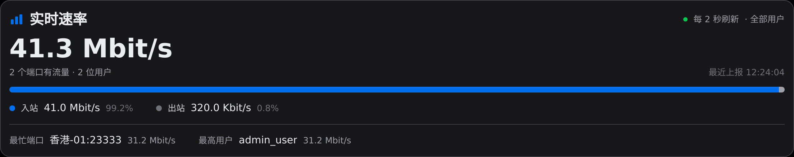
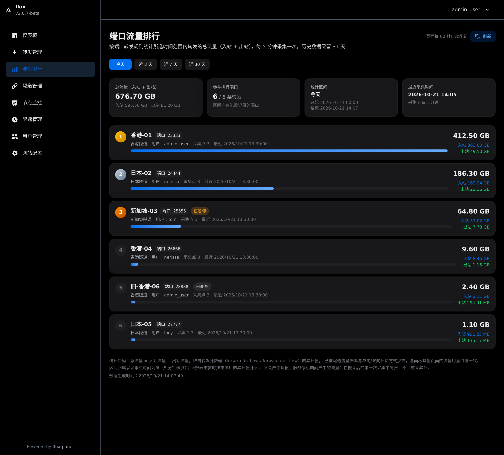

# flux-panel转发面板 哆啦A梦转发面板

# 赞助商
<p align="center">
  <a href="https://vps.town" style="margin: 0 20px; text-align:center;">
    
  </a>

  <a href="https://whmcs.as211392.com" style="margin: 0 20px; text-align:center;">
    
  </a>
</p>


本项目基于 [go-gost/gost](https://github.com/go-gost/gost) 和 [go-gost/x](https://github.com/go-gost/x) 两个开源库，实现了转发面板。
---
## 特性

- 支持按 **隧道账号级别** 管理流量转发数量，可用于用户/隧道配额控制
- 支持 **TCP** 和 **UDP** 协议的转发
- 支持两种转发模式：**端口转发** 与 **隧道转发**
- 可针对 **指定用户的指定隧道进行限速** 设置
- 支持配置 **单向或双向流量计费方式**，灵活适配不同计费模型
- 提供灵活的转发策略配置，适用于多种网络场景


## 本仓库改动

本仓库是 `flux-panel` 的改动版（分支 `feat/port-traffic-ranking`），在保留原有功能的基础上新增：

- **端口流量排行**：每 5 分钟采集各端口转发流量，支持今天 / 近 3 天 / 近 7 天 / 近 30 天排行，历史保留 31 天。
- **仪表盘实时速率**：基于节点上报增量的 10 秒滑动窗口，展示总速率、上下行占比、最忙端口与最高用户，2 秒刷新。





> 实现说明、测试与踩坑记录见 [docs/port-flow-ranking](docs/port-flow-ranking/README.md)。

## 部署流程

> 如果 `raw.githubusercontent.com` 访问不了（国内常见），把命令里的 `https://raw.githubusercontent.com` 换成 `https://ghfast.top/https://raw.githubusercontent.com` 即可。

### 面板端（开发版）

```bash
curl -L https://raw.githubusercontent.com/liang0222/flux-panel/refs/heads/feat/port-traffic-ranking/panel_install.sh -o panel_install.sh && chmod +x panel_install.sh && ./panel_install.sh
```

脚本会下载本仓库的 `docker-compose-v4.yml` / `docker-compose-v6.yml`（使用 `ahmadplayz721/flux-panel-*` 镜像），
按提示输入前端/后端端口后自动启动。默认前端 `6366`、后端 `6365`。

### 节点端（开发版）

```bash
curl -L https://raw.githubusercontent.com/liang0222/flux-panel/refs/heads/feat/port-traffic-ranking/install.sh -o install.sh && chmod +x install.sh && ./install.sh
```

按提示填写「面板后端地址」（`公网IP:6365`）和「节点密钥」（面板「节点监控 → 添加节点」里获取）。
节点二进制与上游 `2.0.7-beta` 一致，无需改动。

> 也可以在面板里直接复制生成的安装命令，它会指向本仓库的 `install.sh`。

**节点连不上？** 按顺序检查：

1. 面板服务器安全组/防火墙放行 **后端端口（默认 6365/TCP）**，节点要能访问它；只开 6366（网页）不够。
2. 「面板后端地址」必须是 `公网IP:6365`：不要带 `http://`、不要填网页端口、不要套 CDN。
3. 在节点服务器执行 `curl http://面板IP:6365/flow/test`，应返回 `test`。
4. 节点上查看服务：`systemctl status flux_agent`、`journalctl -u flux_agent -n 50 --no-pager`。
5. 面板上查看日志：`docker logs springboot-backend | grep -E "节点|secret"`。
6. 修改地址后重新安装：`./install.sh -a 面板IP:6365 -s 节点密钥`（安装脚本会自动做格式校验和连通性检测）。

### 手动部署（可选，等价于上面脚本做的事）

> 使用本仓库发布的镜像：`docker.io/ahmadplayz721/flux-panel-backend:2.0.7-beta`、`docker.io/ahmadplayz721/flux-panel-frontend:2.0.7-beta`（amd64）。

服务器上执行（需要 Docker 与 Compose 插件）：

```bash
mkdir -p /opt/flux-panel && cd /opt/flux-panel

cat > .env <<ENVFILE
JWT_SECRET=$(openssl rand -hex 16)
FRONTEND_PORT=6366
BACKEND_PORT=6365
ENVFILE

cat > docker-compose.yml <<COMPOSEFILE
services:
  backend:
    image: docker.io/ahmadplayz721/flux-panel-backend:2.0.7-beta
    container_name: springboot-backend
    restart: unless-stopped
    environment:
      DB_PATH: /app/data/gost.db
      JWT_SECRET: ${JWT_SECRET}
      LOG_DIR: /app/logs
      JAVA_OPTS: "-Xms256m -Xmx512m -Dfile.encoding=UTF-8 -Duser.timezone=Asia/Shanghai"
    ports:
      - "${BACKEND_PORT:-6365}:6365"
    volumes:
      - sqlite_data:/app/data
      - backend_logs:/app/logs
    healthcheck:
      test: ["CMD", "sh", "-c", "wget --no-verbose --tries=1 --spider http://localhost:6365/flow/test || exit 1"]
      interval: 30s
      timeout: 10s
      retries: 5
      start_period: 60s

  frontend:
    image: docker.io/ahmadplayz721/flux-panel-frontend:2.0.7-beta
    container_name: vite-frontend
    restart: unless-stopped
    ports:
      - "${FRONTEND_PORT:-6366}:80"
    depends_on:
      backend:
        condition: service_healthy

volumes:
  sqlite_data:
    name: sqlite_data
  backend_logs:
    name: backend_logs
COMPOSEFILE

docker compose pull
docker compose up -d
docker compose ps
```

访问 `http://服务器IP:6366`，默认账号见下方。

安全组 / 防火墙需要放行：

- `6366`：面板网页
- `6365`：节点上报流量（节点服务器需要能访问）

### 节点端

节点二进制与上游 `2.0.7-beta` 一致，直接使用上游脚本安装：

```bash
curl -L https://raw.githubusercontent.com/bqlpfy/flux-panel/refs/heads/main/install.sh -o install.sh && chmod +x install.sh && ./install.sh
```

安装时按提示填写「面板后端地址」和「节点密钥」（可在面板「节点监控 → 添加节点」里获取；面板也会生成带 `-a`/`-s` 参数的完整命令，复制执行即可）。

> 想完全自托管节点脚本：把 `install.sh` 里的下载地址换成你自己仓库的 Releases，并上传对应的 `gost-amd64` / `gost-arm64` 二进制。

#### 默认管理员账号

- **账号**: admin_user
- **密码**: admin_user

> ⚠️ 首次登录后请立即修改默认密码！


## 免责声明

本项目仅供个人学习与研究使用，基于开源项目进行二次开发。  

使用本项目所带来的任何风险均由使用者自行承担，包括但不限于：  

- 配置不当或使用错误导致的服务异常或不可用；  
- 使用本项目引发的网络攻击、封禁、滥用等行为；  
- 服务器因使用本项目被入侵、渗透、滥用导致的数据泄露、资源消耗或损失；  
- 因违反当地法律法规所产生的任何法律责任。  

本项目为开源的流量转发工具，仅限合法、合规用途。  
使用者必须确保其使用行为符合所在国家或地区的法律法规。  

**作者不对因使用本项目导致的任何法律责任、经济损失或其他后果承担责任。**  
**禁止将本项目用于任何违法或未经授权的行为，包括但不限于网络攻击、数据窃取、非法访问等。**  

如不同意上述条款，请立即停止使用本项目。  

作者对因使用本项目所造成的任何直接或间接损失概不负责，亦不提供任何形式的担保、承诺或技术支持。  


请务必在合法、合规、安全的前提下使用本项目。  

---
## ⭐ 喝杯咖啡！（USDT）

| 网络       | 地址                                                                 |
|------------|----------------------------------------------------------------------|
| BNB(BEP20) | `0x755492c03728851bbf855daa28a1e089f9aca4d1`                          |
| TRC20      | `TYh2L3xxXpuJhAcBWnt3yiiADiCSJLgUm7`                                  |
| Aptos      | `0xf2f9fb14749457748506a8281628d556e8540d1eb586d202cd8b02b99d369ef8`  |

[](https://www.star-history.com/#bqlpfy/flux-panel&Date)