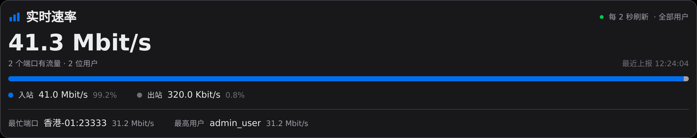
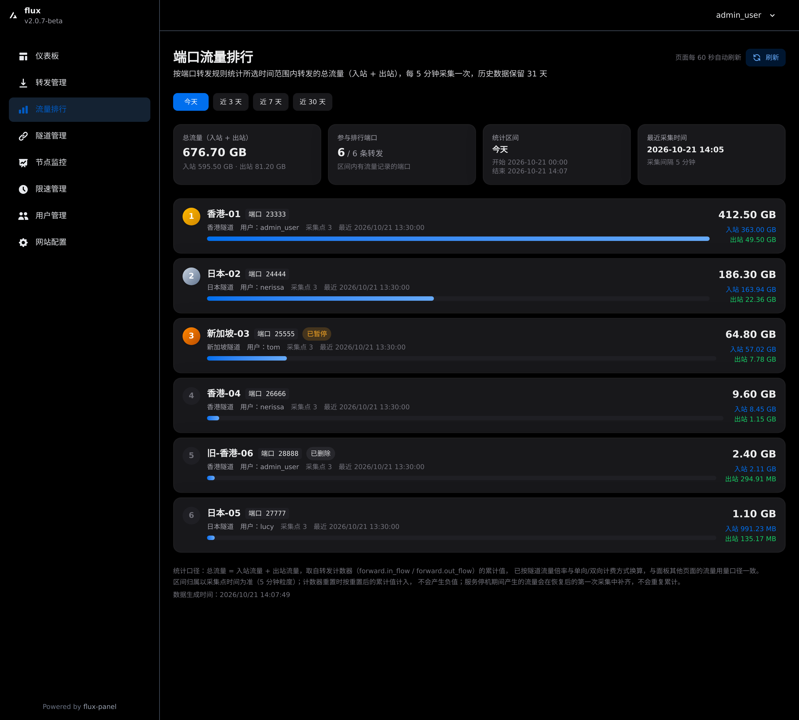

# flux-panel转发面板 哆啦A梦转发面板

# 赞助商
<p align="center">
  <a href="https://vps.town" style="margin: 0 20px; text-align:center;">
    
  </a>

  <a href="https://whmcs.as211392.com" style="margin: 0 20px; text-align:center;">
    
  </a>
</p>


本项目基于 [go-gost/gost](https://github.com/go-gost/gost) 和 [go-gost/x](https://github.com/go-gost/x) 两个开源库，实现了转发面板。
---
## 特性

- 支持按 **隧道账号级别** 管理流量转发数量，可用于用户/隧道配额控制
- 支持 **TCP** 和 **UDP** 协议的转发
- 支持两种转发模式：**端口转发** 与 **隧道转发**
- 可针对 **指定用户的指定隧道进行限速** 设置
- 支持配置 **单向或双向流量计费方式**，灵活适配不同计费模型
- 提供灵活的转发策略配置，适用于多种网络场景


## 本仓库改动

本仓库是 `flux-panel` 的改动版（分支 `feat/port-traffic-ranking`），在保留原有功能的基础上新增：

- **端口流量排行**：每 5 分钟采集各端口转发流量，支持今天 / 近 3 天 / 近 7 天 / 近 30 天排行，历史保留 31 天。
- **仪表盘实时速率**：基于节点上报增量的 10 秒滑动窗口，展示总速率、上下行占比、最忙端口与最高用户，2 秒刷新。





> 实现说明、测试与踩坑记录见 [docs/port-flow-ranking](docs/port-flow-ranking/README.md)。

## 部署流程

面板镜像和 Linux 节点均使用 `2.0.7-beta-r1`，支持 `amd64` 和 `arm64`。已有部署请先备份配置和 SQLite，再升级面板并验证健康状态，最后分批升级节点。

### 面板端

首次安装请在准备存放部署配置的空目录执行。升级时请在原 `docker-compose.yml` 和 `.env` 所在目录执行，并选择「更新」。

```bash
curl -fsSL --proto '=https' --proto-redir '=https' https://raw.githubusercontent.com/liang0222/flux-panel/refs/tags/2.0.7-beta-r1/panel_install.sh -o panel_install.sh && bash panel_install.sh
```

- 默认通过本机 `http://127.0.0.1:6366` 访问面板。先通过本机或 SSH 转发完成首次登录并修改初始密码，再按需配置 HTTPS 反向代理。
- 后端默认绑定 `127.0.0.1:6365`。独立节点需要从可信内网或 VPN 访问后端，按需调整监听地址和防火墙来源。当前节点安装器使用 HTTP 检查并接入后端。
- 面板镜像为 `docker.io/ahmadplayz721/flux-panel-backend:2.0.7-beta-r1` 和 `docker.io/ahmadplayz721/flux-panel-frontend:2.0.7-beta-r1`。手动 Compose 安装、IPv6、备份和回滚见[部署指南](deploy/README.md)。

### 节点端

在节点服务器执行以下命令，按提示填写节点可达的后端 `主机:端口` 和「节点监控 → 添加节点」生成的节点密钥。面板中复制的节点安装命令也指向同一版本。

```bash
curl -fsSL --proto '=https' --proto-redir '=https' https://raw.githubusercontent.com/liang0222/flux-panel/refs/tags/2.0.7-beta-r1/install.sh -o install.sh && bash install.sh
```

安装器按架构下载 [GitHub Release](https://github.com/liang0222/flux-panel/releases/tag/2.0.7-beta-r1) 资产并校验固定 SHA-256。已有节点可用同一命令升级，安装器保留现有配置。

节点连不上时，可从节点服务器访问 `http://<面板后端地址>:6365/flow/test`，确认返回 `test`。自定义后端端口请替换 `6365`。服务状态通过 `systemctl status flux_agent` 检查，近期日志通过 `journalctl -u flux_agent -n 50 --no-pager` 查看。

## 免责声明

本项目仅供个人学习与研究使用，基于开源项目进行二次开发。  

使用本项目所带来的任何风险均由使用者自行承担，包括但不限于：  

- 配置不当或使用错误导致的服务异常或不可用；  
- 使用本项目引发的网络攻击、封禁、滥用等行为；  
- 服务器因使用本项目被入侵、渗透、滥用导致的数据泄露、资源消耗或损失；  
- 因违反当地法律法规所产生的任何法律责任。  

本项目为开源的流量转发工具，仅限合法、合规用途。  
使用者必须确保其使用行为符合所在国家或地区的法律法规。  

**作者不对因使用本项目导致的任何法律责任、经济损失或其他后果承担责任。**  
**禁止将本项目用于任何违法或未经授权的行为，包括但不限于网络攻击、数据窃取、非法访问等。**  

如不同意上述条款，请立即停止使用本项目。  

作者对因使用本项目所造成的任何直接或间接损失概不负责，亦不提供任何形式的担保、承诺或技术支持。  


请务必在合法、合规、安全的前提下使用本项目。  

---
## ⭐ 喝杯咖啡！（USDT）

| 网络       | 地址                                                                 |
|------------|----------------------------------------------------------------------|
| BNB(BEP20) | `0x755492c03728851bbf855daa28a1e089f9aca4d1`                          |
| TRC20      | `TYh2L3xxXpuJhAcBWnt3yiiADiCSJLgUm7`                                  |
| Aptos      | `0xf2f9fb14749457748506a8281628d556e8540d1eb586d202cd8b02b99d369ef8`  |

[](https://www.star-history.com/#bqlpfy/flux-panel&Date)